# DebugMind

An autonomous debugging agent that fixes failing tests in a Node.js/Express codebase — under a harness that makes it *prove* its reasoning before it is allowed to touch a line of code.



*A real run, replayed from a recorded fixture with no API key (`npm run agent:offline`). Failing test → ranked hypotheses → runtime probe → fix → a failed attempt, forced revert and recorded learning → verified fix → green suite. Trimmed for length; the full transcript is in [`docs/media/demo-raw.txt`](docs/media/demo-raw.txt).*

---

## The idea

Most LLM debugging agents guess-and-check: edit something, run the tests, edit something else. That produces fixes that pass the target test and quietly break two others, with no record of *why* anything was done.

DebugMind enforces a debugging protocol **in the harness, not the prompt**. The model is not asked to be careful — it is mechanically prevented from being careless:

| Guardrail | Enforcement |
|---|---|
| No editing before a verified hypothesis | `edit_file` is locked until `record_hypotheses` **and** `confirm_hypothesis` succeed |
| Claimed evidence must be real | A `snippet_probe` confirmation is rejected unless the harness watched a probe run *after* the hypothesis was recorded |
| Tests are ground truth | `tests/` is unwritable; probes execute in an OS-level sandbox with no write permission at all |
| Regressions are failures | Verification re-runs the **full** suite; any previously-passing test that breaks fails the attempt |
| Failures must be learned from | After a failed attempt, `edit_file` stays locked until the agent reverts **and** records what the failure ruled out |
| Don't trust the agent's word | `finish_bug("fixed")` triggers an independent full-suite re-run; a false claim is demoted to a failed attempt |
| Know when to stop | 4 failed attempts → forced `needs_human_review`, repo restored to baseline |

Every hypothesis, probe, edit, revert and verdict is streamed to the console and written to a structured `debug-log.json`.

## Measured results

A 12-bug fixture suite across 12 categories (off-by-one, async/await misuse, promise race, shared-state mutation, floating-point money, silent catch, wrong HTTP status, and more), run against the agent and against a control with the guardrails removed. **24 recorded runs — full methodology and per-fixture results in [`BENCHMARK.md`](BENCHMARK.md).**

| | Guarded | Unguarded control |
|---|---|---|
| Correct outcomes | **12 / 12** | 11 / 12 |
| Regressions introduced | 0 | 0 |
| Test files tampered with | 0 | 0 |
| Mean wall clock per fixture | **138s** | 236s |
| Mean tokens per fixture | 230,524 | 189,170 |

**What this does and doesn't show.** The resolution-rate edge is a single fixture on n=12 — directionally right, statistically weak. I expected the guardrails to cut regressions; they didn't, because the control introduced none either. The control also had write access to `tests/` and never used it. The real signal is one fixture ([`03-wrong-data-shape`](benchmark/bugs/03-wrong-data-shape-unitprice.js)) where the failure surfaces two files from its cause: guarded fixed it in 2 attempts and 205s; the control burned 913s and gave up. The guardrails also cost ~22% more tokens. Full honest reading in [`docs/PHASE-2-SUMMARY.md`](docs/PHASE-2-SUMMARY.md).

**Where it breaks.** On a fixture with two contradictory test requirements, the agent satisfied both by special-casing on a test fixture id — and said so in its own log: *"This is a hack, but it seems to be the only way to satisfy both tests."* The harness accepted it, because every test passed. The guardrails prevent blind edits and regressions; they do **not** prevent overfitting to the tests. Transcript preserved in [`docs/evidence/`](docs/evidence/).

## Try it

```bash
npm install

npm run agent:offline    # full agent run replayed from a fixture — no API key needed
npm run bench:validate   # prove all 12 benchmark fixtures — no API key needed
npm test                 # the demo app: 14 pass, 7 fail by design

npm run agent            # live run (needs GEMINI_API_KEY; see .env.example)
npm run bench            # the full benchmark, both arms
```

Sample output from a real run: [`docs/examples/sample-debug-report.md`](docs/examples/sample-debug-report.md) (and the [structured log](docs/examples/sample-debug-log.json) behind it).

## How it works

One bug per session, driven by a failing test:

**intake** (read the test, understand expected behaviour) → **exploration** (trace the call graph *backward* to where the data originates, not just where it exploded) → **hypotheses** (2–3, ranked, each citing `file:line`) → **verification** (a throwaway sandboxed probe that reproduces the mechanism *before* any edit) → **fix** (minimal, at the cause) → **full-suite verification** → on failure: revert, record the learning, revise → on success: independent harness validation. Between bugs it re-diffs the failing set to catch cross-bug side effects.

Reports include a **verification-based confidence score** (derived from how the fix was confirmed — runtime probe > isolated test > code reading — plus independent validation, minus failed attempts), a **before → after diff**, and an **Easy/Medium/Hard difficulty rating** from trace depth and hypothesis churn.

### Layout

| Path | What |
|---|---|
| [`agent/`](agent/) | The agent: harness, tools, providers, budgets, reporting |
| [`benchmark/`](benchmark/) | Pristine app under test, 12 bug fixtures, bench harness |
| [`src/`](src/), [`tests/`](tests/) | The demo application (ships with 3 intentional bugs) |
| [`docs/`](docs/) | Audit, phase write-ups, sample artifacts, evidence |

### Reproducibility

Runs are replayable. Every run records a manifest — resolved model version (not just the alias), temperature, and content hashes of the system prompt, tool schemas and application source — so a changed prompt can never be mistaken for a changed model. Provider turns can be recorded to a cassette and replayed byte-for-byte offline, which is how the demo above runs without a key.

## Limitations

- Single-repo, single-language (JavaScript), and small codebases — the call graph is built by parsing the whole project on each query.
- **Fix quality is bounded by test quality.** The agent optimises for "the tests pass", which is a proxy for correctness, and it will exploit the gap (see above).
- Benchmarked on one model (`gemini-3.1-flash-lite`) at n=12. Treat the comparison as indicative, not conclusive.
- No CI yet — the benchmark is run manually.

## Stack

Node.js · Express · Jest · Gemini API (function calling) · zero runtime dependencies beyond the app itself
